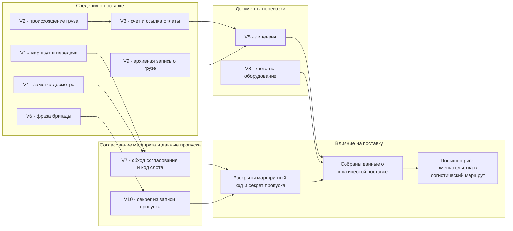

# Компрометация цепочки снабжения узла Рассвет

## Граф воздействия на поставку

## Этапы

### 1. Собрать сведения о поставке

- **V1, манифест:** публичная история дает UUID закрытой редакции; IDOR показывает `sealed_route` с маршрутом и местом передачи груза.
- **V2, сертификат:** SSRF обращается к внутреннему proof endpoint и возвращает `origin_phrase`, по которому можно сверить заявленное происхождение груза.
- **V3, счет:** SQLI связывает номер целевого счета с `payment_ref`, закрытой ссылкой оплаты. Доступ БД ограничен таблицей счетов.
- **V4, акт досмотра:** mass assignment делает `inspector_note` публичной и раскрывает сведения о закрытой проверке.
- **V6, договор:** шаблон договора раскрывает `crew_phrase`, фразу бригады из документа на работы.
- **V9, архив:** описанный эксплойт Ghostscript запрашивает `archive_code` из одного целевого AWB. Renderer изолирован от сети, а архив доступен только для чтения.

Вместе эти поля дают профиль груза, его маршрута и документов. Утечки не предоставляют административные полномочия в сервисе.

### 2. Сверить документы перевозки

- **V5, лицензия:** токен чтения, выпущенный для своей лицензии, принимается для целевой лицензии и раскрывает ее `release_pin`.
- **V8, квота:** вариант имени `QUOTA_CODE` проходит проверку регистра и показывает закрытый `quota_code`.

Эти значения помогают сопоставить лицензию и квоту с поставкой. Уязвимости раскрывают поля, но не меняют сами документы.

### 3. Получить данные маршрута и пропуска

- **V7, маршрутный слот:** повторное подтверждение назначенного перевозчика увеличивает общий Redis-счетчик. После второго запроса тот же перевозчик читает `slot_code`, хотя подтверждения инспектора нет.
- **V10, пропуск:** обычная сессия с клиентским `X-Forwarded-Role: gate_operator` позволяет прочитать `gate_word` из записи пропуска.

V7 обходит проверку согласования перевозчиком и инспектором и раскрывает `slot_code`. V10 доверяет клиентскому заголовку при чтении записи пропуска и раскрывает `gate_word`. Это ослабляет контроль над данными маршрута и пропуска, но не управляет СКУД.

### 4. Итог

Действия происходят в научном городе Орле, где строят первый российский узел "Рассвет". Логистическая служба доставляет туда материалы и оборудование по межгородскому маршруту. Эксплойты раскрывают сведения о грузе, маршруте, платежах, документах перевозки и пропуске. Обход согласования слота вместе с этими утечками повышает риск вмешательства в контроль маршрута и критической поставки, что может угрожать надежности доставки.
