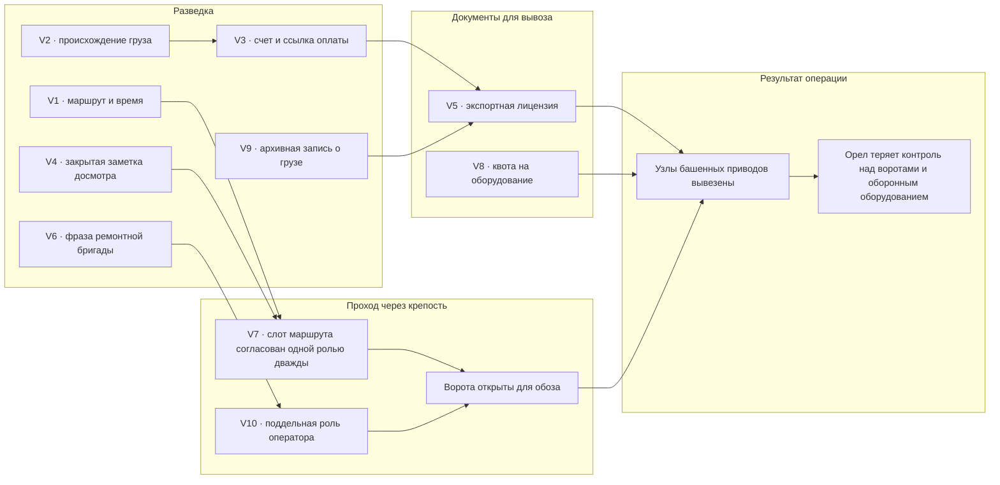

# Захват крепости Орел

## Граф вторжения

## Этапы

### 1. Собрать маршрут и проверить прикрытие

- **V1, манифест:** публичная история дает UUID закрытой редакции; IDOR показывает маршрут обоза и место передачи.
- **V2, сертификат:** SSRF получает внутреннее доказательство для указанного сертификата. Это позволяет проверить заявленную легенду происхождения груза.
- **V3, счет:** SQL injection связывает номер целевого счета с закрытой ссылкой оплаты. Доступ БД ограничен таблицей счетов.
- **V4, акт досмотра:** mass assignment делает заметку инспектора публичной. В сценарии это раскрывает содержание скрытой проверки и ее обстоятельства; сама заметка не редактируется эксплойтом.
- **V6, договор:** шаблон договора раскрывает фразу бригады. Она подтверждает, под каким предлогом люди и инструмент попадут внутрь.
- **V9, архив:** старая накладная связывает груз с архивной записью. RCE срабатывает только в рендерере и читает только файл целевого AWB.

Эти результаты складываются в одну легенду: известны путь, документы на груз, содержание досмотра, архивный след и назначение ремонтной бригады. Ни один из этих шагов не выдает полномочия администратора.

### 2. Подготовить вывоз оборудования

- **V5, лицензия:** токен чтения, выпущенный для своей лицензии, принимается на целевой лицензии. Полученное поле подтверждает запись о разрешенном вывозе.
- **V8, квота:** вариант имени `QUOTA_CODE` проходит проверку регистра и показывает закрытый код квоты. Квота задает документированное основание и объем вывоза.

Лицензия и квота нужны вместе в истории операции: первое основание разрешает экспорт, второе описывает допустимый объем груза. Уязвимости не подменяют сами документы целиком.

### 3. Провести обоз

- **V7, маршрутный слот:** слот назначен перевозчику и инспектору. Повторное подтверждение перевозчика увеличивает общий Redis-счетчик до порога, хотя подписи двух разных ролей нет. После этого перевозчик получает закрытый код слота.
- **V10, пропуск ворот:** обычная сессия вместе с клиентским `X-Forwarded-Role: gate_operator` открывает закрытое поле пропуска.

Ошибочное согласование помогает получить маршрутный допуск; доверие заголовку позволяет прочитать данные пропуска. В сюжете эти документы дают обозу окно прохода и запись для ворот. Это две разные ошибки контроля доступа, а не единый обход авторизации.

### 4. Итог

Обоз проходит под прикрытием медицинской поставки и ремонта, а затем экспортная лицензия и квота оправдывают вывоз узлов башенных приводов. Сочетание утечки маршрута, поддельной логистической уверенности, обхода двухстороннего согласования и подделки роли у ворот дает противнику контроль над ключевым потоком снабжения и доступом в крепость. После вывоза деталей Орел не способен надежно закрыть ворота и удержать оборонную инфраструктуру, что в последствии приведет к падению крепости.
